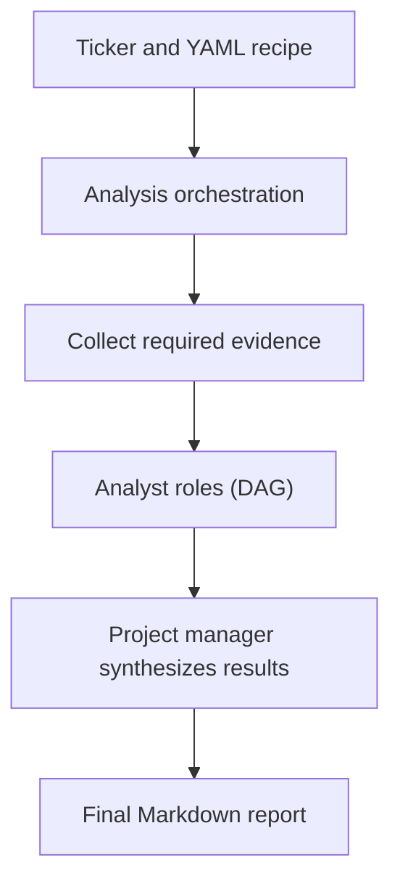
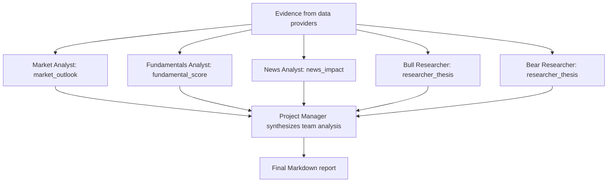

# TradingAgents Next

English | [简体中文](README.zh-CN.md)

[](https://www.python.org/)
[](LICENSE)
[](https://github.com/hotwind2015/tradingagents_next)

TradingAgents Next is a config-driven multi-agent framework for investment research on a specified stock ticker. Inspired by [TradingAgents](https://github.com/TauricResearch/TradingAgents), this project focuses on making the analysis workflow more configurable and extensible through pluggable analyst roles, data providers, and LLM providers.

This project generates research reports only. It does not execute trades and does not provide investment advice.

## Features

- **Configurable analysis teams**: Define analyst roles, team members, model tiers, and required evidence in YAML.
- **Extensible plugins**: Add custom analyst roles, data providers (`DataProvider`), and LLM providers.
- **DAG-based workflow**: Build the execution graph from each role's declared inputs and outputs.
- **Evidence and run records**: Preserve effective configuration, evidence, role outputs, prompts, logs, and reports for traceability.
- **Multilingual reports**: Generate reports in Simplified Chinese or English.

## Architecture and Execution Flow



The recipe's `team`, `consumes`, and `produces` settings determine which analyst roles run and how they depend on each other. Built-in or custom plugins provide the data sources, roles, and LLMs; Jinja2 templates prepare prompts. Evidence, role outputs, and run records are saved under `runs/<run_id>/`.

### Default Team DAG Example

Analyst roles consume evidence and produce their research independently. The project manager synthesizes their outputs. Branches represent dependencies, not concurrent execution; the actual graph is determined by the recipe.



## Requirements

- Python 3.11 or later
- Network access to retrieve market, fundamental, and news data
- An available OpenAI-compatible API and API key for real analysis with the default LLM provider

## Installation

Run an editable install from the project root:

```bash
pip install -e .
```

Using a virtual environment is recommended to isolate project dependencies.

## Quick Start

### Default Configuration

```bash
tradingagents run --ticker AAPL
```

The default configuration is `config/default.yaml`. It uses `yfinance` for market, fundamental, and news data, and an OpenAI-compatible LLM provider for analysis. Before running, create a `.env` file in the project root and configure your model API:

```dotenv
TRADINGAGENTS_LLM_API_KEY=your-api-key
TRADINGAGENTS_LLM_MODEL=gpt-4o-mini
# For a compatible service, configure this as required by your provider:
# TRADINGAGENTS_LLM_BASE_URL=https://your-provider.example/v1
```

`TRADINGAGENTS_LLM_BASE_URL` is optional. Do not commit a `.env` file containing real credentials.

### Custom Configuration and Plugins

Pass a YAML recipe with `--config` and load custom plugins with `--plugin-dir`:

```bash
tradingagents run --ticker AAPL --config ./my_config/mock_test.yaml --plugin-dir=./my_plugins
```

See the [Plugin Development Guide](docs/plugin-development.md) for complete provider, LLM, and role examples, Jinja2 templates, and a Mock recipe. The local `tests/` and `plugins/` example directories are not published to GitHub, so the guide includes examples that you can copy into your own directories.

## Configuration

The default configuration is in `config/default.yaml`. A user recipe is merged with the defaults and can define:

- `roles`: Role IDs, consumed and produced data types, prompt templates, and model tiers (`quick` or `deep`).
- `team`: Analyst roles and the final project manager role.
- `data.provider_chain`: Ordered data providers for each evidence type.
- `models.provider`: LLM provider ID; `models.quick` and `models.deep`: parameters for each model tier.
- `output.lang`: Report language, such as `zh-CN` or `en-US`.
- `prompt_persistence`: Prompt persistence strategy: `full`, `digest`, or `off`.

Configuration values can also be overridden from the command line:

```bash
# Generate the report in English
tradingagents run --ticker AAPL --lang en-US

# Override any config key (use dots for nested fields)
tradingagents run --ticker AAPL --set models.deep.model=gpt-4o

# Specify multiple plugin directories
tradingagents run --ticker AAPL --plugin-dir=./my_plugins --plugin-dir=./my_more_plugins
```

## Plugin Extensions

The plugin manager recursively scans Python files in the specified directories. Each plugin class must declare a `plugin_type` and the corresponding ID:

| Plugin type | ID attribute | Purpose |
| --- | --- | --- |
| `provider` (`DataProvider`) | `provider_id` | Supplies evidence required by analyst roles |
| `role` | `role_id` | Performs analysis or synthesizes the final report |
| `llm` | `llm_id` | Calls a large language model |

Provider, role, and LLM IDs in the recipe must match the IDs declared by the plugins. Custom analyst and project manager prompt templates can be placed in a plugin directory's `templates/` folder and referenced in the role configuration. Templates are rendered with Jinja2. Each `--plugin-dir` contributes a `templates/` search path, for example `./my_plugins/templates/`.

The final report currently uses the project-level `templates/report.j2`; plugin template paths are used for analyst and project manager prompts.

## Run Artifacts and Resuming

By default, each run writes its records to `runs/<run_id>/`, typically including:

- `report.<language>.md`: Final analysis report
- `effective_config.yaml`: Effective configuration used for the run
- `evidence_manifest.json` and `raw/`: Evidence manifest and raw data
- `outputs/`: Structured outputs from each role
- `prompts/`: Prompts saved according to the configured persistence strategy
- `run.log` and `integrity.chain`: Run log and evidence integrity record

If a run is interrupted, resume it with its run ID:

```bash
tradingagents run --ticker AAPL --resume <run_id>
```

## CLI Reference

```text
tradingagents run --ticker <symbol>
  [--config <YAML path>]
  [--plugin-dir <plugin directory> ...]
  [--lang <language code>]
  [--set KEY=VALUE ...]
  [--resume <run_id>]
```

## Project Structure

```text
config/          Default YAML configuration
templates/       Built-in analyst and report templates
i18n/            Domain-organized translations (zh-CN, en-US)
tradingagents/   CLI, orchestration, configuration, roles, data, LLM, and reporting
docs/            Plugin development guides
examples/        Graded examples (01_minimal → 09_full_team) — docs + living tests
tests/           Internal test suite + test plugins (excluded from distribution)
```

## Development Workflow

This project follows an **Examples-Driven Development** model:

```bash
# 1. Mock test (logic verification, no network)
tradingagents dev test --plugin-dir examples/01_minimal/plugins --ticker AAPL --mock

# 2. Real run (end-to-end with real data/LLM)
tradingagents run --ticker AAPL --config examples/01_minimal/recipe.yaml --plugin-dir examples/01_minimal/plugins
```

See [Plugin Development Guide](docs/plugin-development.md#10-examples-driven-development-workflow) for the complete workflow, examples catalog, and mock vs real configuration mapping.

## License

## License

This project is released under the [Apache License 2.0](LICENSE). Use, modification, and redistribution are subject to its terms.

## Acknowledgments

- Most of this project's code was developed with assistance from **DeepSeek**. Thank you for the help.
- **NVIDIA** provided the `nemotron-3-ultra-550b-a55b` model used for testing.
- **GitHub Copilot** assisted with code optimization and multilingual support.
- Thanks to [TauricResearch/TradingAgents](https://github.com/TauricResearch/TradingAgents) for the design inspiration.
