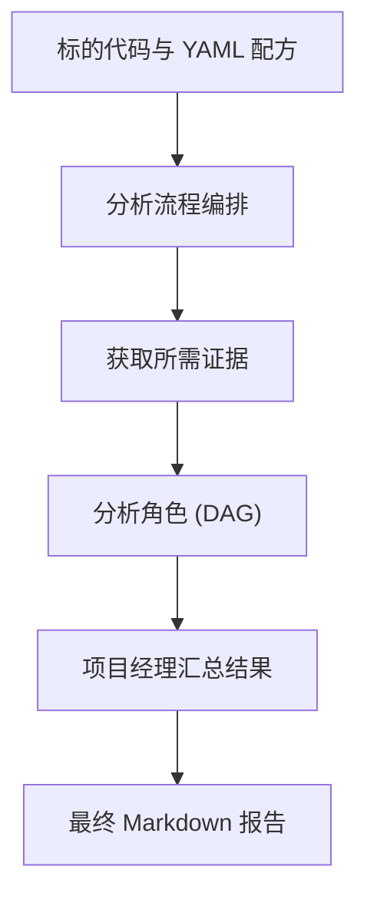
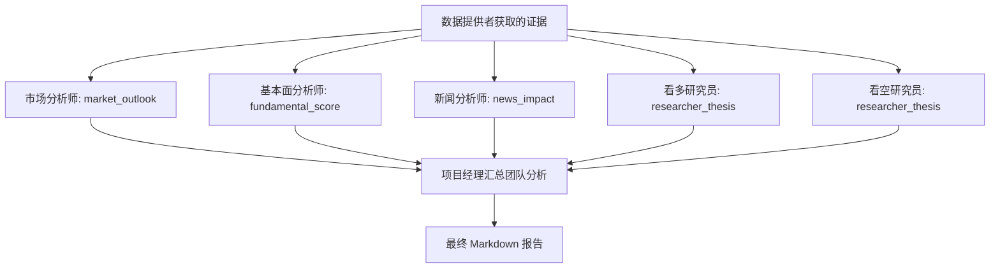

# TradingAgents Next

[English](README.md) | 简体中文

[](https://www.python.org/)
[](LICENSE)
[](https://github.com/hotwind2015/tradingagents_next)

TradingAgents Next 是一个面向指定股票标的的、配置驱动的多智能体投资分析框架。项目受到 [TradingAgents](https://github.com/TauricResearch/TradingAgents) 启发，重点提升分析流程的可配置性和扩展性：可以组合分析角色、数据提供者和大语言模型提供者，并根据角色间的数据依赖自动编排执行。

本项目生成研究分析报告，不会执行交易，也不构成投资建议。

## 功能概览

- **可配置分析团队**：通过 YAML 配置分析角色、团队成员、模型档位及所需数据。
- **可扩展插件**：支持自定义分析角色、数据提供者（DataProvider）和 LLM 提供者。
- **DAG 分析流程**：根据角色声明的输入和输出依赖自动安排执行顺序。
- **证据与运行记录**：保存有效配置、数据证据、角色输出、提示词、运行日志和最终报告，便于追溯。
- **多语言报告**：默认生成中文报告，也可切换为英文。

## 系统架构与执行流程



配方中的 `team`、`consumes` 和 `produces` 决定参与分析的角色及其依赖关系。数据源、角色和大模型由内置或自定义插件提供；Jinja2 模板负责组装提示词。证据、角色输出和运行记录保存在 `runs/<run_id>/` 下。

### 默认团队的 DAG 示例

各分析角色分别消费证据并产出研究结果，再由项目经理汇总。图中的分支表示依赖关系，不代表并发执行；实际 DAG 由配方决定。



## 环境要求

- Python 3.11 或更高版本
- 获取行情、基本面和新闻数据需要网络连接
- 使用默认 LLM 提供者进行真实分析时，需要可用的 OpenAI 兼容 API 及 API Key

## 安装

在项目根目录执行可编辑安装：

```bash
pip install -e .
```

建议在虚拟环境中安装，以隔离项目依赖。

## 快速开始

### 默认配置

```bash
tradingagents run --ticker AAPL
```

默认配置位于 `config/default.yaml`，使用 `yfinance` 获取行情、基本面和新闻数据，使用 `FRED` 获取宏观经济指标，通过 OpenAI 兼容的 LLM 提供者生成分析。运行前，在项目根目录创建 `.env` 并设置 API 密钥：

```dotenv
# LLM（必需）
TRADINGAGENTS_LLM_API_KEY=your-api-key
TRADINGAGENTS_LLM_MODEL=gpt-4o-mini
# 如使用兼容服务，可按服务商要求设置：
# TRADINGAGENTS_LLM_BASE_URL=https://your-provider.example/v1

# FRED 宏观经济数据（完整分析必需）
TRADINGAGENTS_FRED_API_KEY=your-fred-api-key
# 免费申请：https://fred.stlouisfed.org/docs/api/api_key.html
```

`TRADINGAGENTS_LLM_BASE_URL` 为可选项。请勿将包含真实密钥的 `.env` 文件提交到版本库。

### 自定义配置和插件

通过 `--config` 指定 YAML 配方，并通过 `--plugin-dir` 加载自定义插件：

```bash
tradingagents run --ticker AAPL --config ./my_config/mock_test.yaml --plugin-dir=./my_plugins
```

完整的 provider、LLM、role 插件实现、Jinja2 模板和 Mock 配方示例见[插件开发参考](docs/plugin-development.zh-CN.md)。项目本地的 `tests/` 与 `plugins/` 示例目录不会发布到 GitHub，因此指南中包含了可自行复制的示例。

## 配置说明

默认配置见 `config/default.yaml`。用户配置会与默认配置合并，可在其中调整：

- `roles`：角色 ID、输入/输出数据、提示词模板和模型档位（`quick` 或 `deep`）。
- `team`：参与分析的角色列表和最终报告角色。
- `data.provider_chain`：每类证据使用的数据提供者及其顺序。
- `models.provider`：LLM 提供者 ID；`models.quick` 和 `models.deep`：不同模型档位的参数。
- `output.lang`：报告语言，例如 `zh-CN` 或 `en-US`。
- `prompt_persistence`：提示词保存策略，可设为 `full`、`digest` 或 `off`。

命令行也可以直接覆盖配置项：

```bash
# 将报告语言设为英文
tradingagents run --ticker AAPL --lang en-US

# 覆盖配置中的任意键（点号表示嵌套字段）
tradingagents run --ticker AAPL --set models.deep.model=gpt-4o

# 可重复指定多个插件目录
tradingagents run --ticker AAPL --plugin-dir=./my_plugins --plugin-dir=./my_more_plugins
```

## 扩展插件

插件目录会递归扫描其中的 Python 文件。插件类需要声明 `plugin_type` 及对应 ID：

| 插件类型 | ID 属性 | 用途 |
| --- | --- | --- |
| `provider`（DataProvider） | `provider_id` | 提供分析角色所需的证据数据 |
| `role` | `role_id` | 执行分析或汇总报告 |
| `llm` | `llm_id` | 调用大语言模型 |

配置中的 provider、role 和 LLM ID 必须与插件声明的 ID 一致。自定义角色和项目经理的提示词模板可以放在插件目录下的 `templates/` 中，并在角色配置中引用；模板以 Jinja2 渲染。插件模板搜索目录为每个 `--plugin-dir` 下的 `templates/`，例如 `./plugins/templates/`。

当前最终报告模板由项目内的 `templates/report.j2` 加载；插件目录中的模板搜索路径用于角色和项目经理的提示词模板。

## 运行结果与续跑

默认情况下，每次运行都会在 `runs/<run_id>/` 下生成记录，通常包括：

- `report.<语言>.md`：最终分析报告
- `effective_config.yaml`：本次运行使用的有效配置
- `evidence_manifest.json`、`raw/`：证据清单及原始数据
- `outputs/`：各角色的结构化输出
- `prompts/`：按提示词保存策略记录的提示词
- `run.log`、`integrity.chain`：运行日志和证据完整性记录

若运行中断，可使用原运行 ID 继续执行：

```bash
tradingagents run --ticker AAPL --resume <run_id>
```

## 命令行参数

```text
tradingagents run --ticker <标的代码>
  [--config <YAML路径>]
  [--plugin-dir <插件目录> ...]
  [--lang <语言代码>]
  [--set KEY=VALUE ...]
  [--resume <run_id>]
```

## 项目结构

```text
config/          默认 YAML 配置
templates/       内置分析角色及报告模板
i18n/            按领域分层的多语言文案（zh-CN、en-US）
tradingagents/   CLI、编排、配置、角色、数据、LLM 和报告实现
```

## 开源协议

本项目采用 [Apache License 2.0](LICENSE) 开源。使用、修改或分发本项目时，请遵守协议条款。

## 致谢

- 本项目的大部分代码在 **DeepSeek** 的协助下完成，感谢 DeepSeek 提供的帮助。
- 感谢 **NVIDIA** 提供的 `nemotron-3-ultra-550b-a55b` 大模型，本项目使用该模型进行测试。
- 感谢 **GitHub Copilot** 在代码优化和多语言处理方面提供的协助。
- 感谢 [TauricResearch/TradingAgents](https://github.com/TauricResearch/TradingAgents) 为本项目提供设计灵感。
