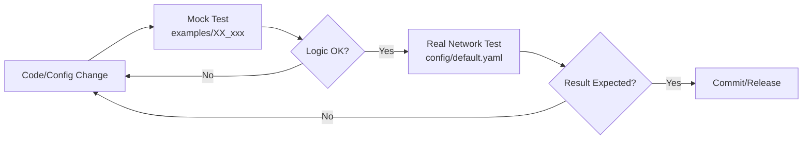

# Plugin Development Guide

English | [简体中文](plugin-development.zh-CN.md)

This guide documents the supported plugin types and includes copyable interface, template, and recipe examples.

## 1. How Plugins Are Loaded

The project supports three plugin types. The configuration concept `dataprovider` maps to the plugin type `provider` in the current implementation.

| Plugin purpose | `plugin_type` | Required ID attribute | Core interface |
| --- | --- | --- | --- |
| Analyst role or project manager | `role` | `role_id` | `prepare_context()`, `parse_output()` |
| Evidence data provider (`DataProvider`) | `provider` | `provider_id` | `fetch(DataRequest)` |
| Large language model | `llm` | `llm_id` | `invoke(prompt, model_config)` |

At runtime, pass one or more plugin directories with `--plugin-dir`. Python files are scanned recursively. Plugin classes must be constructible without arguments and declare the appropriate `plugin_type` and ID. A custom plugin overrides an already registered plugin of the same type and ID.

```text
my_plugins/
├── providers/
│   └── mock_provider.py
├── llms/
│   └── mock_llm.py
├── roles/
│   └── mock_roles.py
└── templates/
    ├── analysts/
    │   └── mock_fundamentals.j2
    └── project_manager_custom.j2
```

Plugin directories are passed explicitly on the command line; do not rely on the unused `plugindir` YAML field. Relative config and template paths are resolved from the current working directory, so run commands from the project root.

## 2. Analysis Workflow

1. The recipe's `team` selects the analyst roles and the final project manager.
2. Analyst roles declare the evidence they need with `consumes`. The data router selects providers in the order specified by `data.provider_chain` and stores the returned evidence in the current run directory.
3. The system builds a DAG from each role's `consumes` and `produces` declarations. Jinja2 templates render prompts from the role context and evidence, and the configured LLM generates a response.
4. Analysis results are parsed into `RoleOutput` objects and saved under `runs/<run_id>/outputs/`.
5. The project manager synthesizes the team results. The report renderer then uses a Markdown report template to create the final report.

Keep evidence type names consistent: `data.required`, `RawEvidence.evidence_type`, and analyst `consumes` values should use the same names. Provider IDs in `provider_chain` must match each provider's `provider_id`. A role's `produces` values should match the `consumes` values of downstream roles, usually the project manager.

## 3. Data Provider Example

A data provider implements the `DataProvider` interface. Declare the evidence types it supports and return a list of `RawEvidence` objects from `fetch()`. If a required evidence type cannot be fetched, the run is aborted.

```python
from tradingagents.providers.base import DataProvider, DataRequest, RawEvidence


class MockProvider(DataProvider):
    plugin_type = "provider"
    provider_id = "mock"
    provides = {"fundamentals"}

    def fetch(self, req: DataRequest) -> list[RawEvidence]:
        if req.evidence_type != "fundamentals":
            return []

        return [
            RawEvidence(
                evidence_type="fundamentals",
                provider=self.provider_id,
                method="mock_fetch",
                summary="Mock data: revenue grew 15% year over year and net income grew 8%.",
                raw_payload={"revenue_growth": 0.15},
            )
        ]
```

`DataRequest` includes `evidence_type`, `ticker`, `as_of`, and `params`. A production provider can read credentials or other settings in its no-argument constructor and use `fetch()` to call an external data source.

## 4. LLM Provider Example

An LLM plugin receives a prompt and model configuration and returns a string. A common pattern is to return JSON and have the role's `parse_output()` convert it into a `RoleOutput`.

```python
import json
from typing import Any

from tradingagents.llm.base import LLMClient


class MockLLM(LLMClient):
    plugin_type = "llm"
    llm_id = "mock"

    def invoke(self, prompt: str, model_config: dict[str, Any]) -> str:
        return json.dumps(
            {
                "fundamental_score": 0.8,
                "narrative": "This is a mock analysis; no real model is called.",
                "cited_evidence": [],
            },
            ensure_ascii=False,
        )
```

This Mock implementation is useful for testing the workflow and plugin wiring, but it does not analyze the input prompt.

## 5. Analyst Role and Project Manager Examples

An analyst role implements the `AnalystRole` interface. `prepare_context()` selects evidence and returns the template context; `parse_output()` converts the model response into a `RoleOutput`.

```python
import json
from typing import Any

from tradingagents.evidence.view import EvidenceView
from tradingagents.roles.base import AnalystRole, RoleOutput
from tradingagents.run.context import RunContext


class MockFundamentalsAnalyst(AnalystRole):
    plugin_type = "role"
    role_id = "mock_fundamentals"
    consumes = {"fundamentals"}
    produces = {"fundamental_score"}
    template = "analysts/mock_fundamentals.j2"

    def prepare_context(
        self, evidence: EvidenceView, ctx: RunContext
    ) -> dict[str, Any]:
        return {"evidence": evidence.to_prompt_items(self.consumes)}

    def parse_output(self, raw_response: str) -> RoleOutput:
        data = json.loads(raw_response)
        return RoleOutput(
            role_id=self.role_id,
            fields={"fundamental_score": data["fundamental_score"]},
            narrative=data["narrative"],
            cited_evidence=data.get("cited_evidence", []),
        )
```

A project manager implements the `ProjectManager` interface. It receives the team's `RoleOutput` list and evidence view, then places the analysis results in its prompt context:

```python
import json

from tradingagents.roles.base import ProjectManager, RoleOutput


class MockProjectManager(ProjectManager):
    plugin_type = "role"
    role_id = "mock_pm"
    consumes = {"fundamental_score"}
    template = "project_manager_custom.j2"

    def prepare_context(self, outputs, evidence, ctx):
        return {
            "analyst_outputs": [
                {"role": output.role_id, "narrative": output.narrative}
                for output in outputs
            ]
        }

    def parse_output(self, raw_response: str) -> RoleOutput:
        data = json.loads(raw_response)
        return RoleOutput(
            role_id=self.role_id,
            fields={"final_report": data["narrative"]},
            narrative=data["narrative"],
            cited_evidence=data.get("cited_evidence", []),
        )
```

The current executor looks up the project manager plugin using `team.project_manager`. For a custom project manager, use the same ID for its key under `roles`, `team.project_manager`, and the plugin class's `role_id`.

The local `mock_test_v2.yaml` uses `project_manager` as the team configuration key but declares `mock_pm` as the role's `role_id`. With the current lookup behavior, this does not load the custom manager whose ID is `mock_pm`. The copyable recipe below aligns all three IDs.

## 6. Jinja2 Templates

The context returned by an analyst's `prepare_context()` is passed to its template. The runner also injects `ticker` and `output_language`. Every variable referenced by a template must be present in its context.

File: `my_plugins/templates/analysts/mock_fundamentals.j2`

```jinja2
Analyze the fundamentals of {{ ticker }} and respond in {{ output_language }}.

Evidence:

- [{{ item.evidence_id }}] {{ item.summary }}


Return JSON with fundamental_score, narrative, and cited_evidence.
```

Template paths in role configuration are relative to the `templates/` directory, for example `analysts/mock_fundamentals.j2`. The built-in `templates/` directory is searched before plugin directories; use unique template names to avoid collisions. Plugin `templates/` directories are searched for analyst and project manager prompts. The final report currently uses the project-level `templates/report.j2`.

Project manager template: `my_plugins/templates/project_manager_custom.j2`

```jinja2
Synthesize the team's analysis for {{ ticker }} and respond in {{ output_language }}.

- {{ item.role }}: {{ item.narrative }}


Return JSON with narrative and cited_evidence.
```

## 7. Mock Recipe Example

The minimal recipe below connects a Mock data provider, analyst role, and LLM. Save it as `my_config/mock_test.yaml` and place the plugin classes shown above under `my_plugins/`.

```yaml
id: mock_test
version: "0.1"
target_profile: equity
evidence_schema: v1
prompt_persistence: full

data:
  required: [fundamentals]
  provider_chain:
    fundamentals: [mock]

models:
  provider: mock
  quick: {temperature: 0.1}
  deep: {temperature: 0.2}

roles:
  mock_fundamentals:
    role_id: mock_fundamentals
    display_name_key: role.fundamentals
    consumes: [fundamentals]
    produces: [fundamental_score]
    template: analysts/mock_fundamentals.j2
    model_tier: quick
  mock_pm:
    role_id: mock_pm
    display_name_key: role.pm
    consumes: [fundamental_score]
    produces: [final_report]
    template: project_manager_custom.j2

team:
  analysts: [mock_fundamentals]
  project_manager: mock_pm
```

Run it with:

```bash
tradingagents run --ticker AAPL --config ./my_config/mock_test.yaml --plugin-dir ./my_plugins
```

This example uses a Mock provider and Mock LLM, so it does not require a real model API key. If the provider also returns Mock data, no market-data service is needed. In a real role, parse the actual model response and cite only `evidence_id` values present in the evidence manifest.

## 8. `smoke_v2.yaml` and `mock_test_v2.yaml`

| Local example | What it demonstrates | Requirements |
| --- | --- | --- |
| `smoke_v2.yaml` | A full team using built-in roles, `yfinance`, and `openai`, covering market, fundamental, and news analysis, bull/bear research, and project management. It is a reference for built-in components, not a custom-plugin example. | Network access, available data sources, and credentials for an OpenAI-compatible API. |
| `mock_test_v2.yaml` | A smaller recipe using the `mock` data provider and LLM, useful for understanding custom plugin wiring. | The corresponding local Mock plugin files. |

In a working tree that contains the local test fixtures, run `smoke_v2.yaml` with:

```bash
tradingagents run --ticker AAPL --config tests/recipes/smoke_v2.yaml
```

The `tests/` and `plugins/` directories are excluded from the GitHub repository, so these local example paths may not exist after cloning. Create your own plugin and configuration files using the examples in this guide.

## 9. Testing & Mock Plugin Isolation Rules

**Critical**: Test and mock code must never leak into production packages (`tradingagents/`).

| ❌ Forbidden | ✅ Required |
|--------------|-------------|
| Defining `Mock*`, `Test*`, `Fake*` classes in `tradingagents/` | Place test plugins in `tests/plugins/` or `examples/XX_xxx/plugins/` |
| Importing mock implementations from production modules | Load test plugins via `--plugin-dir tests/plugins` or `--plugin-dir examples/.../plugins` |
| Shipping mock code in PyPI package | Keep `tests/` and `examples/` out of distribution |

### Directory Structure for Test Plugins

```
tests/
└── plugins/
    ├── providers/
    │   └── mock_provider.py
    ├── llm/
    │   └── mock_llm.py
    └── roles/
        └── mock_roles.py
```

### Usage in Tests

```python
from tradingagents.run.plugin_manager import PluginManager
from pathlib import Path

pm = PluginManager()
pm.discover_all([Path(__file__).parent / "plugins"])
MockLLM = pm.get("llm", "mock")
llm = MockLLM()
```

### Examples as Living Tests

Each example in `examples/XX_xxx/` contains a complete, runnable plugin set under `plugins/`. These serve dual purpose:
- **Documentation**: Users copy them as starting points
- **Regression tests**: CI runs `tradingagents dev test --plugin-dir examples/XX_xxx/plugins --mock`

This ensures examples stay working and demonstrate real plugin patterns.

## 10. Examples-Driven Development Workflow

### Standard R&D Flow

Every change follows a **two-stage verification** pipeline:



### Mock vs Real Configuration Mapping

| Aspect | Mock Stage (`examples/XX_xxx/`) | Real Stage (`config/default.yaml`) |
|--------|----------------------------------|------------------------------------|
| **Recipe** | `examples/XX_xxx/recipe.yaml` | `config/default.yaml` |
| **Data Provider** | `mock` | `yfinance` (or production provider) |
| **LLM** | `mock` llm | `openai` / compatible API |
| **Plugin Loading** | `--plugin-dir examples/XX_xxx/plugins` | Official entry_points (zero config) |
| **Run Command** | `tradingagents dev test --mock` | `tradingagents run` |

### Examples Catalog (Standardized)

| Example | Mock Test Focus | Real Test Verification |
|---------|-----------------|------------------------|
| `01_minimal` | Core orchestration, evidence flow, report gen | Basic team with built-ins |
| `02_custom_role` | Role plugin, `configure()`, new `prepare_context` | Custom analyst in real team |
| `03_custom_provider` | Provider plugin, `provider_args`, `get_raw()` | Real data source integration |
| `04_custom_llm` | LLM plugin, `provider_args` passthrough | Production LLM (OpenAI/Azure/etc.) |
| `05_args_extension` | Full `args`/`provider_args`/`model provider_args` chain | Production configs with custom params |
| `06_rich_context` | `get_raw()`, `get_prior_fields()`, shared state, LangGraph prep | Real analysis with full context |
| `07_langgraph_analyst` | Analyst internal StateGraph | Complex multi-step reasoning |
| `08_plugin_packaging` | entry_points, local override, versioning | PyPI publish, team sharing |
| `09_full_team` | Full ensemble: all roles, multi-provider, multi-model | Production-grade run |

### Three-Stage Validation Command

Each example **must** pass all three stages:

```bash
# 1. Spec validation (plugin contracts)
tradingagents dev validate --plugin-dir examples/XX_xxx/plugins

# 2. Mock test (logic verification, no network)
tradingagents dev test --plugin-dir examples/XX_xxx/plugins --ticker AAPL --mock

# 3. Real run (end-to-end with real data/LLM)
tradingagents run --ticker AAPL --config examples/XX_xxx/recipe.yaml --plugin-dir examples/XX_xxx/plugins
```

### CI Integration

```yaml
# .github/workflows/ci.yml (concept)
- name: Validate All Examples
  run: |
    for ex in examples/*/; do
      tradingagents dev validate --plugin-dir "$ex/plugins"
      tradingagents dev test --plugin-dir "$ex/plugins" --ticker AAPL --mock
    done
```

### Mock Maintenance Principle

> **Mock evolves with logic** — When you change orchestration, context, or plugin contracts, update the corresponding mock plugins in `examples/XX_xxx/plugins/` **in the same PR**. This keeps mock tests as accurate regression guards.

### Directory Structure Standard

```
examples/
├── 01_minimal/
│   ├── recipe.yaml
│   ├── plugins/          # Optional: only if custom plugins needed
│   └── README.md
├── 02_custom_role/
│   ├── plugins/
│   │   └── roles/
│   │       └── my_analyst.py
│   ├── recipe.yaml
│   └── README.md
...
├── shared/
│   ├── mock_data/        # Shared mock payloads for --mock mode
│   └── scripts/
│       └── run_all_examples.sh
```

---

This convention ensures **mock tests are first-class citizens**, not afterthoughts, and prevents the "mock drift" problem where mocks become stale and give false confidence.

## 11. Evidence Schema & Template Value Paths

When a run executes, every piece of evidence fetched by data providers is saved as a JSON file under `runs/<run_id>/raw/ev-XXXX.json`. These files contain not only the raw payload but also auto-generated metadata that helps template authors discover the correct value access paths.

### 11.1 Evidence JSON Structure

Each `ev-XXXX.json` contains:

| Field | Description |
|-------|-------------|
| `indicator`, `values`, ... | Provider-specific raw payload |
| `_template_meta` | Auto-generated template guidance (see below) |
| `_evidence_meta` | Complete evidence metadata (evidence_id, type, provider, summary, lineage, quality scores, etc.) |

### 11.2 `_template_meta` — Template Author's Guide

```json
"_template_meta": {
  "raw_payload_schema": {
    "type": "object",
    "jinja_path": "raw_payload",
    "properties": {
      "indicator": { "type": "string", "jinja_path": "raw_payload.indicator", "example": "rsi" },
      "values": {
        "type": "object",
        "jinja_path": "raw_payload.values",
        "properties": {
          "2026-11-24": { "type": "string", "jinja_path": "raw_payload.values.2026-11-24", "example": "56.85" }
        },
        "keys": ["2026-11-25", "2026-11-24", ...],
        "example": { "2026-11-25": "N/A", "2026-11-24": "56.85" }
      },
      "as_of_date": { "type": "string", "jinja_path": "raw_payload.as_of_date", "example": "2026-11-25" },
      "look_back_days": { "type": "integer", "jinja_path": "raw_payload.look_back_days", "example": 30 }
    }
  },
  "jinja_paths": [
    "raw_payload.indicator",
    "raw_payload.values",
    "raw_payload.values.2026-11-24",
    "raw_payload.as_of_date",
    "raw_payload.look_back_days",
    "raw_payload.description"
  ],
  "top_level_keys": ["indicator", "values", "as_of_date", "look_back_days", "description"]
}
```

#### Key Fields

| Field | Purpose |
|-------|---------|
| `raw_payload_schema` | Recursive JSON Schema of the entire payload with `jinja_path` for every field |
| `jinja_paths` | Flat list of all leaf-level access paths — **copy-paste ready for templates** |
| `top_level_keys` | Quick overview of root-level keys |

### 11.3 How to Use in Templates

1. **Run once** to generate evidence files:
   ```bash
   tradingagents run --ticker AAPL --config config/default.yaml --lang en-US
   ```

2. **Open any `runs/<run_id>/raw/ev-XXXX.json`** and look at `_template_meta.jinja_paths`

3. **Copy the path** and use it in your Jinja2 template with `ev.raw_payload.` prefix:
   ```jinja2
   
   - [{{ ev.evidence_id }}] {{ ev.summary }}
   
     **Key Values (last 5 days):**
     
     - {{ k }}: {{ v }}
     
   
   
   ```

   > **Important**: Use bracket notation `ev.raw_payload["values"]` instead of dot notation `ev.raw_payload.values` when the key might conflict with Python dict methods (like `values()`, `keys()`, `items()`).

### 11.4 `_evidence_meta` — Complete Evidence Context

```json
"_evidence_meta": {
  "evidence_id": "ev-0001",
  "evidence_type": "market_indicators",
  "provider": "yfinance_kline",
  "method": "stockstats",
  "summary": "rsi values from 2026-10-26 to 2026-11-25",
  "fetched_at": "2026-11-25T14:00:38.853340+00:00",
  "fallback_hit": false,
  "metadata": {
    "source_provider": "yfinance_kline",
    "source_method": "stockstats",
    "processing_level": "raw",
    "processing_chain": ["fetch"],
    "quality_scores": { "completeness": 1.0, "freshness": 1.0 }
  },
  "lineage": []
}
```

Use this for debugging, audit trails, or displaying provenance in reports.

### 11.5 Provider Best Practice

When implementing a new `DataProvider`, ensure `RawEvidence.raw_payload` is a **JSON-serializable dict**. The schema inference works automatically for any structure (objects, arrays, nested). No code changes needed in the store — it's fully generic.

If your provider has special fields that template authors should know about, consider adding a `"_template_hint"` key in the raw payload (optional, merged into `_template_meta`):
```python
RawEvidence(
    ...
    raw_payload={
        "my_custom_field": [...],
        "_template_hint": {
            "category": "technical",
            "description": "Custom volatility metric, iterate with ev.raw_payload.my_custom_field"
        }
    }
)
```

---

This convention ensures **template authors never need to read provider code** — just run once, open the evidence JSON, copy `jinja_paths`, and paste into templates.
